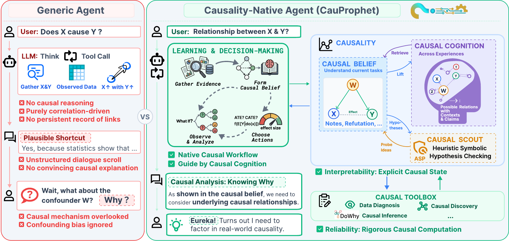
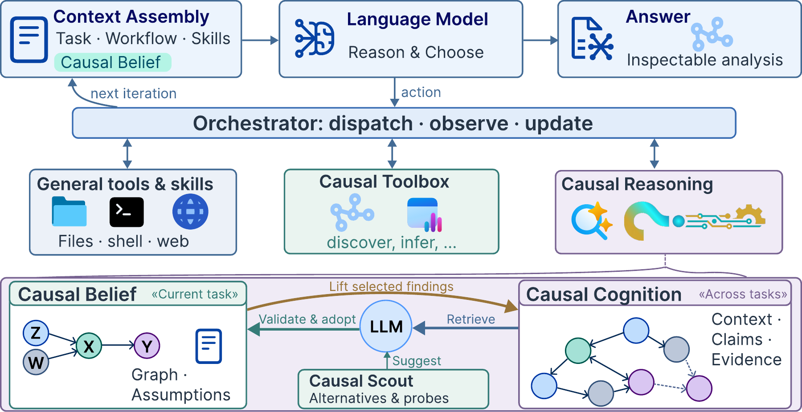
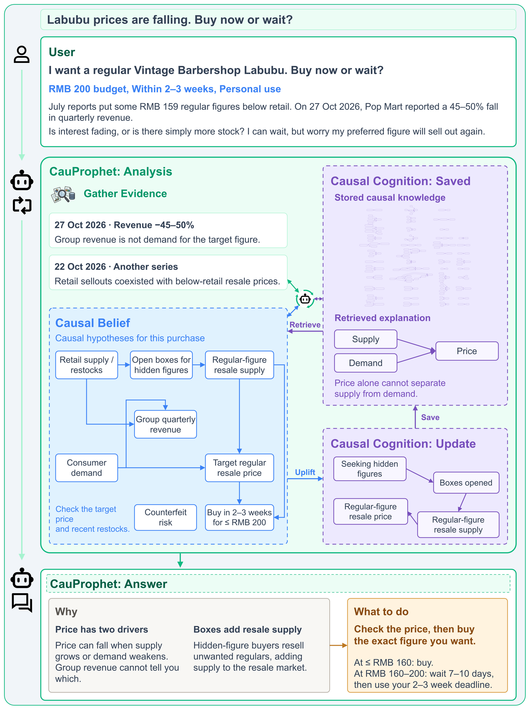
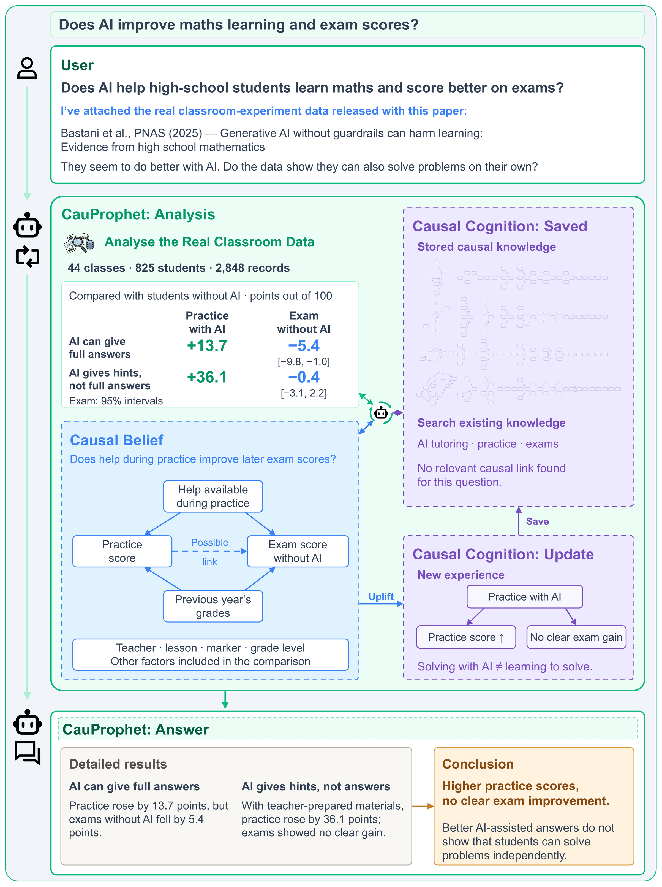

<p align="center">
  
</p>

# CauProphet: Teaching Agents to Develop Causal Cognition like Humans

**Kaiwen Wu · Chaochao Lu**

[arXiv](https://arxiv.org/abs/2610.32477) · [PDF](https://arxiv.org/pdf/2610.32477)

**An agent that builds, revises, and reuses causal understanding.**

[Overview](#overview) · [How It Works](#how-it-works) · [Quick Start](#quick-start) · [Case Studies](#case-studies) · [Citation](#citation)

## Overview

CauProphet is an interactive assistant for causal reasoning, discovery, and inference. It combines a language model with explicit causal beliefs, persistent causal knowledge, and analysis tools. You can interact with it through a terminal or a web interface.



*CauProphet makes causal hypotheses explicit and revises them as evidence arrives, retaining useful knowledge across tasks.*

This repository contains the interactive application, its web interface, and the bundled causal tools and skills.

## How It Works

- **Causal Belief:** task-local variables, proposed mechanisms, evidence, assumptions, and uncertainty that the agent revises during analysis.
- **Causal Cognition:** reusable causal relationships and written explanations retained across tasks, with their supporting evidence and conditions.
- **Causal Scout:** symbolic checks of candidate mechanisms and suggestions for observations that could distinguish them.
- **Causal Toolbox:** Python tools for data diagnosis, causal discovery, and causal inference when the available data and assumptions support them.

<details>
<summary><strong>View the architecture</strong></summary>



*Relevant knowledge and current evidence inform a task-local belief. Tool observations can revise that belief, while selected findings are retained for future tasks.*

</details>

## Quick Start

### Requirements

- **Bun 1.3 or later** (verified with Bun 1.3.14).
- **Python 3.10 or later** and **uv**, available on your `PATH`.
- An **OpenAI-compatible endpoint**, an API key, and a model that supports tool calling.
- Internet access for dependency installation and model requests.
- Linux or macOS; Windows users can use WSL.

### Install and launch

Clone the repository, then install and launch the application:

```bash
git clone https://github.com/OpenCausaLab/CauProphet.git
cd CauProphet
bun install --frozen-lockfile
bun run build
bun run start
```

Installation also installs the web dependencies. The build creates the web interface in `web/dist`.

On first launch, the setup wizard asks for:

1. Your API base URL, API key, and model name.
2. The model's context window size, in tokens.
3. A workspace directory. Press **Enter** to use `cauprophet-workspace` next to this repository, or provide a path to another empty directory outside the repository. Setup creates the directory if needed and saves its absolute path.

The workspace holds conversations, causal beliefs, retained knowledge, and analysis files. Setup copies the bundled instructions, skills, and Python tools into it, then installs the Python dependencies with `uv`. Subsequent launches check the locked environment again, so an interrupted installation can resume.

Choose **Terminal (CLI)** to chat in the terminal, or **Web UI** to open the browser interface at **http://localhost:3001**. New installations default to English; a saved language preference is preserved. Press `Ctrl+C` in the launching terminal to stop the application.

### Configuration

The setup wizard saves your endpoint, API key, model, and workspace path locally in `~/.cauprophet/config.json`. You can update these settings in the web interface's **Settings** panel. An existing legacy configuration in `~/.causalclaw` is reused when no new configuration exists.

DuckDuckGo is the default web search provider and requires no search API key. Brave Search and Bocha are optional providers configured through Settings.

Keep your local configuration and runtime workspace outside the source repository. For an independent configuration, set `CAUPROPHET_CONFIG_DIR` to a separate directory before launching.

## Case Studies

Two single-request cases from the paper, run with `claude-opus-5-5`. The figures present edited prompts and answers alongside the recorded analysis, Causal Belief, and Causal Cognition.

### Labubu prices are falling. Buy now or wait?

> I want a regular Labubu figure, with RMB 200 to spend and two to three weeks to buy it. Prices have fallen, but I worry it will sell out again. Should I buy now or wait?

CauProphet retrieves a supply-and-demand explanation and checks recent reporting. Its Causal Belief separates demand for the target figure from group revenue and considers how buyers seeking hidden figures can increase the resale supply of regular figures. **The recommendation: check the exact figure's price and use a price threshold and deadline to decide.** The proposed resale mechanism is saved as a written experience in Causal Cognition.

<details>
<summary><strong>View the Labubu analysis and purchase recommendation</strong></summary>



</details>

### Does AI improve maths learning and exam scores?

> I've attached the real classroom data released with this paper. Students seem to do better with AI, but does that mean they can also solve maths problems and score better on exams without it?

CauProphet analyzes the [classroom data](https://github.com/obastani/GenAICanHarmLearning) released with [Bastani et al., PNAS (2025)](https://doi.org/10.1073/pnas.2422633122). Relative to students without AI, adjusted scores on a 100-point scale show two different patterns:

- **AI can give full answers:** practice scores rise by 13.7 points, while exam scores without AI fall by 5.4 points.
- **AI gives hints with teacher-prepared materials:** practice scores rise by 36.1 points, with no clear exam improvement.

**Higher AI-assisted practice scores do not demonstrate better independent learning.** CauProphet records the causal factors in a task-local belief and saves this distinction as a written experience in Causal Cognition.

<details>
<summary><strong>View the classroom-data analysis and conclusion</strong></summary>



</details>

## Repository Layout

```text
.
├── assets/       # Paper figures used in this README
├── src/          # Agent, causal state, tools, and terminal interfaces
├── server/       # Web server and agent workers
├── web/          # Web interface
├── python/       # Causal analysis tools and locked Python dependencies
├── templates/    # Workspace instructions and bundled skills
├── package.json
├── bun.lock
├── tsconfig.json
├── CITATION.cff
└── LICENSE
```

## Troubleshooting

- **Setup cannot find Python or uv:** install them and confirm `python3 --version` and `uv --version` work in the same terminal.
- **Python dependency installation fails:** enter the workspace directory and run `uv sync` to inspect the installation error.
- **Workspace cannot be opened:** check that its configured path is a directory you can access and write to.
- **Web interface is missing:** run `bun run build` from the repository root and restart.
- **Model requests fail:** check the base URL, API key, model name, and tool-calling support in Settings.

## Citation

If you use CauProphet in your research, please cite our paper:

```bibtex
@article{wu2026cauprophet,
  title   = {{CauProphet}: Teaching Agents to Develop Causal Cognition like Humans},
  author  = {Wu, Kaiwen and Lu, Chaochao},
  journal = {arXiv preprint arXiv:2610.32477},
  year    = {2026},
  url     = {https://arxiv.org/abs/2610.32477}
}
```

Machine-readable citation metadata is available in [CITATION.cff](CITATION.cff).

## Acknowledgments

CauProphet builds on open-source software including Bun, React, React Flow, causal-learn, DoWhy, LiNGAM, and clingo. Dependency versions are recorded in the JavaScript and Python lockfiles.

## License

The application source is released under the [MIT License](LICENSE). Third-party dependencies retain their own licenses.
